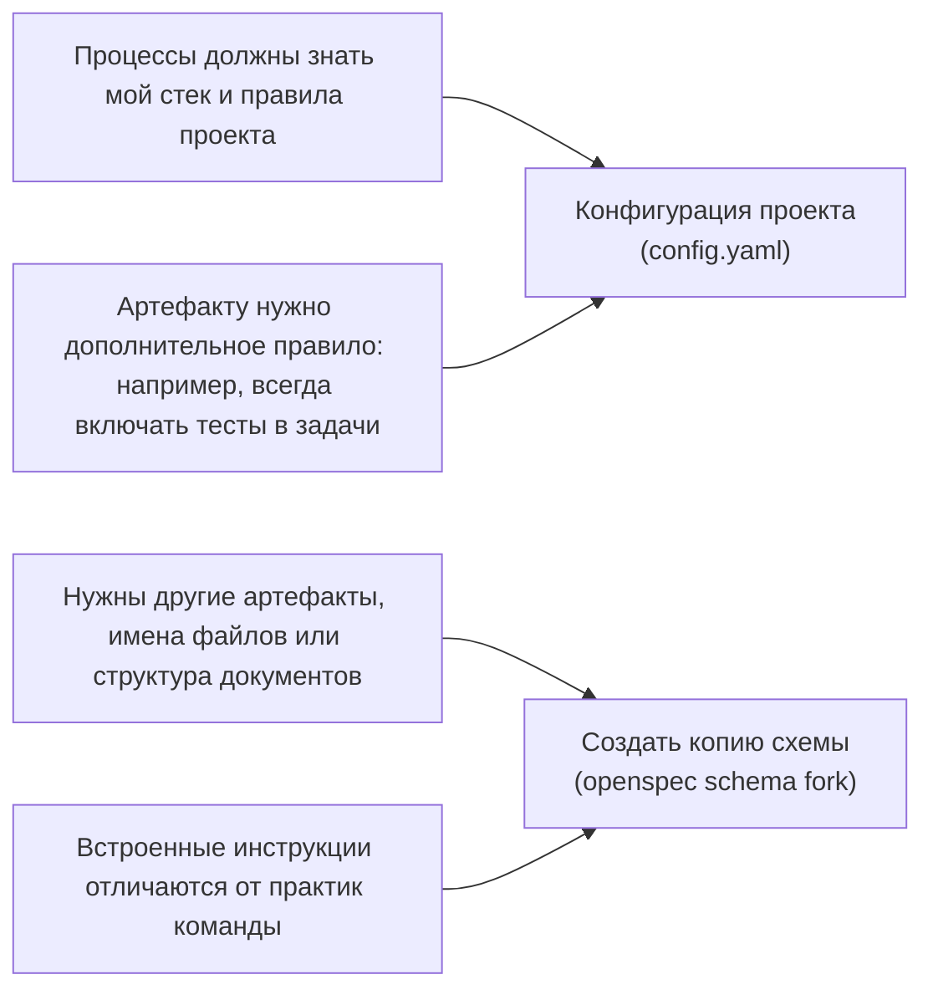

<!-- translation-source: docs-lab/customize/overview.md -->
> Оригинал: [docs-lab/customize/overview.md (английский)](../../../../docs-lab/customize/overview.md). Проверенная версия: [6d04a1b58ded](https://github.com/alzhutenkov/OpenSpec/blob/6d04a1b58dedc95729d34e4f223d9d483aae210a/docs-lab/customize/overview.md).

# Обзор

> Варианты настройки OpenSpec.

OpenSpec поддерживает несколько способов настройки. Здесь описано, что меняет каждый из них и когда его выбирать.

## Что можно настроить

| Вариант | Что меняет | Когда использовать |
|---|---|---|
| [Профили](profiles.md) | Набор процессов и форму установки: навыки, команды или обе формы | Нужны дополнительные процессы и способы работы либо требуется убрать ненужные |
| [Конфигурация проекта](project-config.md) | Инструкции каждого запуска: контекст, правила и указания операций (`config.yaml`) | Планирование должно учитывать ваши требования, например всегда включать тесты Playwright в задачи |
| [Схемы](schemas.md) | Создаваемые артефакты, их порядок и шаблоны | Нужны другие файлы планирования, разделы или форматы |

## Не уверены, что выбрать?

Конфигурация и схемы задают два уровня настройки. Выбирайте по необходимой глубине изменений:

- **Начните с [конфигурации проекта](project-config.md):** она требует меньше работы и обычно достаточна. Стандартные артефакты сохраняются; вы добавляете контекст и правила.
- **Создайте копию [схемы](schemas.md), если дополнений недостаточно:** конфигурация только дополняет основной процесс. Она может добавить правило «задачи всегда включают тесты», но не убрать техническое решение или переименовать файл. Для этого нужна схема. Команда fork создаёт редактируемую копию.

*Здесь fork означает команду `openspec schema fork`, а не форк репозитория Git. Подробности: [Схемы](schemas.md).*

