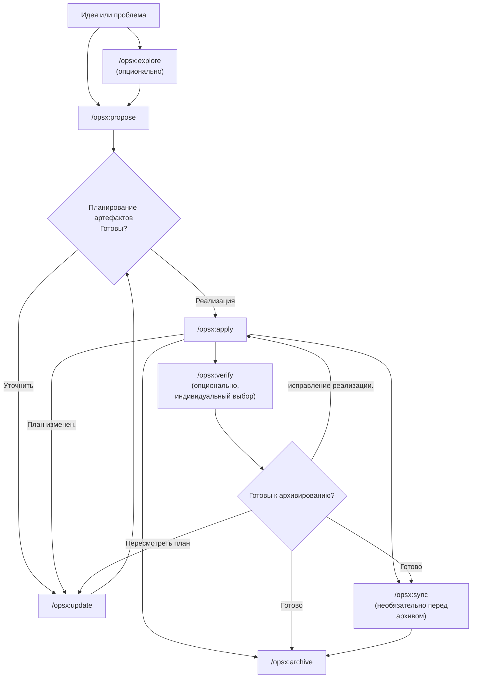
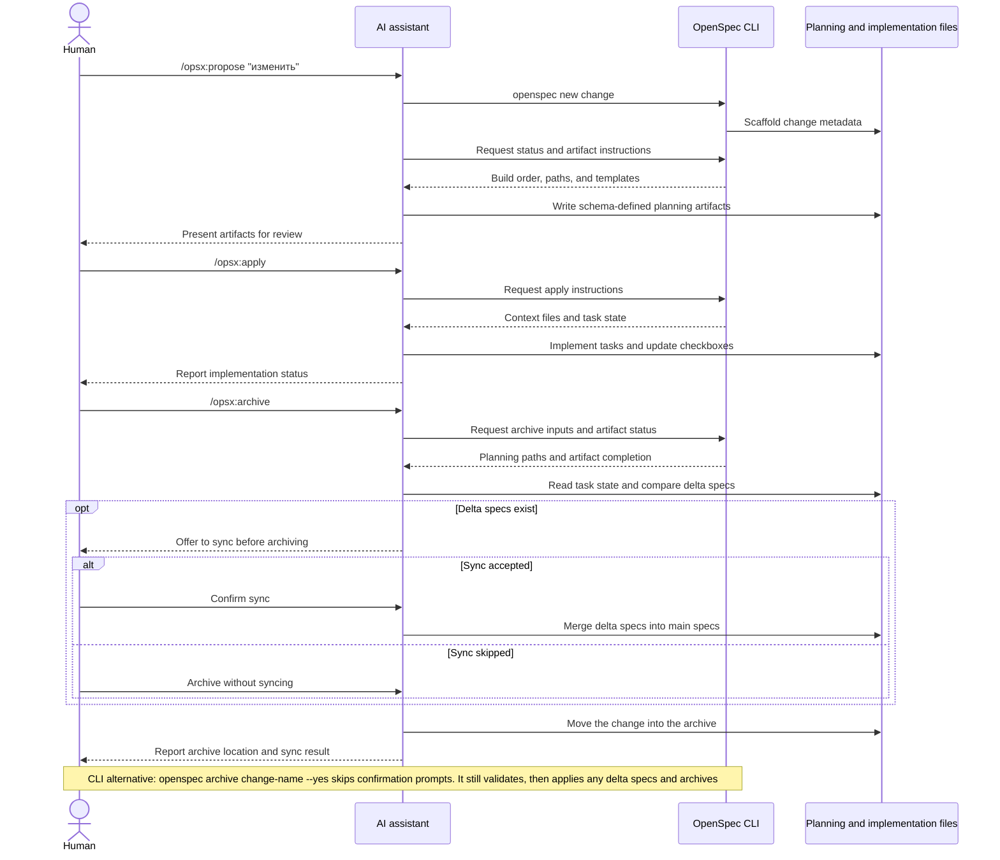

<!-- translation-source: docs/workflows.md -->
> Оригинал: [docs/workflows.md (английский)](../../workflows.md). Проверенная версия: [6d04a1b58ded](https://github.com/alzhutenkov/OpenSpec/blob/6d04a1b58dedc95729d34e4f223d9d483aae210a/docs/workflows.md).

> [!WARNING]
> Прежняя документация: материал может быть устаревшим. [Актуальный русский раздел](../README.md).

<a id="workflows"></a>
# Рабочие процессы

В этом руководстве описаны общие шаблоны рабочих процессов для OpenSpec и указано, когда использовать каждый из них. Базовую настройку см. в разделе [Начало работы](getting-started.md). Справочную информацию о командах см. в разделе [Команды](commands.md).

<a id="philosophy-actions-not-phases"></a>
## Философия: действия, а не этапы

Традиционные рабочие процессы заставляют вас проходить этапы: планирование, затем реализация и завершение. Но настоящая работа не укладывается в рамки.

OPSX использует другой подход:

```text
Традиционный (с фазовой синхронизацией):

  ПЛАНИРОВАНИЕ ────────► РЕАЛИЗАЦИЯ ───────► ГОТОВО
      │                    │
      │ «Невозможно вернуться» │
      └────────────────────┘

OPSX (плавные действия):

  предложение ──► спецификации ──► дизайн ──► задачи ──► реализация
```

**Основные принципы:**

- **Действия, а не этапы**. Команды — это то, что вы можете сделать, а не этапы, на которых вы застряли.
- **Зависимости являются движущей силой**. Они показывают, что возможно, а не то, что требуется дальше.

> **Настройка:** Рабочие процессы OPSX управляются схемами, которые определяют последовательности артефактов. См. [Настройка](customization.md) для получения подробной информации о создании пользовательских схем.

<a id="workflow-at-a-glance"></a>
## Краткий обзор рабочего процесса

Рабочий процесс по умолчанию остается гибким: исследование и проверка не являются обязательными,
и вы можете обновлять артефакты планирования всякий раз, когда реализация обнаруживает что-то новое.



AI-помощник управляет рабочим процессом, а CLI предоставляет
детерминированные инструкции по созданию леса, состоянию и артефактам:



<a id="two-modes"></a>
## Два режима

<a id="default-quick-path-core-profile"></a>
### Быстрый путь по умолчанию (профиль `core`)

по умолчанию устанавливается версия `core`, которая обеспечивает:
- `/opsx:explore`
- `/opsx:propose`
- `/opsx:apply`
- `/opsx:update`
- `/opsx:sync`
- `/opsx:archive`

Типичный поток:

```text
/opsx:explore ──► /opsx:propose ──► /opsx:apply ──► /opsx:sync ──► /opsx:archive
  (необязательно)
```

<a id="start-by-exploring-the-habit-worth-forming"></a>
#### Начните с изучения (привычка, которую стоит сформировать)

`/opsx:explore` является частью профиля по умолчанию, а не расширенным дополнением. Это шаг, который нужно сделать, когда у вас есть проблема, но еще нет плана, что в большинстве случаев случается с помощником ИИ.

```text
Вы: /opsx:explore

AI: Что бы вы хотели изучить?

Вы: Результаты поиска устарели. Я не уверен, что это кешируется,
     индексация или сам запрос.

AI: Дай-ка я посмотрю... [читает уровень службы поиска и кэша]
     Это индекс: он перестраивается только каждую ночь, поэтому изменения не отображаются.
     до следующего дня. Два варианта: перестроить при записи (простой,
     большая нагрузка) или аннулирование кэша с коротким TTL (больше движущихся частей,
     меньше нагрузки). Учитывая, что объем записи невелик, восстановление при записи
     исправление очистки. Хотите оценить это?

Вы: Да.

Вы: /opsx:propose перестроить индекс поиска при записи
```

Explore никогда не пишет код и ничего больше, пока вы не попросите или не скажете «да», когда он предложит. Это свободный разговор без каких-либо ставок, который превращает смутное беспокойство в конкретные изменения, поэтому последующее предложение является резким. Уже точно знаете, чего хотите? Пропустите его и перейдите прямо к `/opsx:propose`. Полное руководство: [Сначала исследуйте](explore.md).

<a id="expandedfull-workflow-custom-selection"></a>
### Расширенный/полный рабочий процесс (пользовательский выбор)

Если вам нужны явные команды создания каркаса и сборки (`/opsx:new`, `/opsx:continue`, `/opsx:ff`, `/opsx:verify`, `/opsx:bulk-archive`, `/opsx:onboard`), включите их с помощью:

```bash
openspec config profile
openspec update
```

<a id="workflow-patterns-expanded-mode"></a>
## Шаблоны рабочих процессов (расширенный режим)

<a id="quick-feature"></a>
### Быстрая функция

Когда вы знаете, что хотите построить, и вам просто нужно выполнить:

```text
/opsx:new ──► /opsx:ff ──► /opsx:apply ──► /opsx:verify ──► /opsx:archive
```

**Пример диалога:**

```text
Вы: /opsx:new кнопка добавления выхода из системы

AI: Создано openspec/changes/add-logout-button/
     Готово создать: предложение

Вы: /opsx:ff

ИИ: Создание всех артефактов планирования...
     ✓ proposal.md
     ✓ specs/
     ✓ design.md
     ✓ tasks.md
     Готово к внедрению!

Вы: /opsx:apply

ИИ: Работа над задачами...
     ✓ В заголовок добавлена кнопка выхода из системы.
     ✓ Реализована очистка сессии.
     ✓ Добавлен диалог подтверждения.
     Все задания выполнены!

Вы: /opsx:archive

AI: ✓ Объединены спецификации.
     ✓ Архивное изменение
```

**Подходит для:** небольших и средних функций, исправлений ошибок, простых изменений.

<a id="exploratory"></a>
### Исследовательский

Если требования неясны или вам необходимо сначала изучить:

```text
/opsx:explore ──► /opsx:new ──► /opsx:continue ──► ... ──► /opsx:apply
```

**Пример диалога:**

```text
Вы: /opsx:explore

AI: Что бы вы хотели изучить?

Вы: Я хочу улучшить производительность загрузки страниц, но не уверен.
     где находятся узкие места.

ИИ: Позвольте мне помочь разобраться...
     [Analyzes bundle sizes, identifies slow queries, reviews
     шаблоны рендеринга компонентов]

     Я обнаружил три основных узких места:
     1. большие неоптимизированные изображения.
     2. синхронная выборка данных в ProductList.
     3. повторная визуализация при изменении контекста.

     К чему бы вы хотели обратиться в первую очередь?

Вы: Давайте разберемся с проблемой получения данных.

Вы: /opsx:new оптимизируете получение списка продуктов

AI: Создано изменение. Готово создать: предложение

Вы: /opsx:continue

AI: Создание предложения на основе наших исследований...
     [Writes proposal incorporating investigation insights]

     Готово к созданию: спецификации, дизайн
     Что бы вы хотели дальше?

Вы: /opsx:continue

AI: Создание спецификаций...
```

**Подходит для:** оптимизации производительности, отладки, архитектурных решений, неясных требований.

<a id="parallel-changes"></a>
### Параллельные изменения

Работайте над несколькими изменениями одновременно:

```text
Изменение A: /opsx:new ──► /opsx:ff ──► /opsx:apply (в разработке)
                                         │
                                    переключение контекста
                                         │
Изменение B: /opsx:new ──► /opsx:ff ──────► /opsx:apply
```

**Пример диалога:**

```text
Вы: Я работаю над надстройкой темного режима, но меня втянули в исправление ошибки.

Вы: /opsx:new fix-login-redirect

AI: Создано openspec/changes/fix-login-redirect/

Вы: /opsx:ff

AI: ✓ Созданы артефакты планирования.

Вы: /opsx:apply

AI: Работаем над исправлением перенаправления входа в систему...
     [Implements the fix]
     Все задания выполнены!

Вы: /opsx:archive

AI: ✓ Архивировано перенаправление исправления входа в систему

Вы: Давайте вернемся в темный режим.

Вы: /opsx:apply add-dark-mode

AI: Возобновление добавления темного режима...
     Продолжаем выполнять задачу 2.3: обновить заголовок...
```

**Подходит для:** параллельных рабочих процессов, срочных прерываний, совместной работы в команде.

Если у вас есть несколько завершенных изменений, используйте `/opsx:bulk-archive`:

```text
Вы: /opsx:bulk-archive

AI: Найдено 3 выполненных изменения:
     - добавить темный режим (все задачи выполнены)
     - исправление перенаправления входа в систему (все задачи выполнены)
     - нижний колонтитул обновления (все задачи выполнены)

     Проверка конфликтов спецификаций...
     ⚠ add-dark-mode и update-footer касаются спецификаций/ui/

     Проверка кодовой базы для устранения...
     Оба изменения реализованы. Применять будем в хронологическом порядке.

     Заархивировать все три изменения?

Вы: Да

AI: ✓ В архиве добавлен темный режим.
     ✓ Архивировано перенаправление исправления входа в систему.
     ✓ Архивное обновление-нижний колонтитул
     спецификации объединены в следующем порядке: add-dark-mode → update-footer.
```

Массовый архив обнаруживает, когда несколько изменений затрагивают одни и те же спецификации, и разрешает конфликты, проверяя, что на самом деле реализовано.

<a id="completing-a-change"></a>
### Завершение изменения

Рекомендуемый порядок завершения:

```text
/opsx:apply ──► /opsx:verify ──► /opsx:archive
                    │                 │
              проверяет запросы на синхронизацию.
              реализация при необходимости
```

<a id="verify-check-your-work"></a>
#### Проверка: проверьте свою работу

`/opsx:verify` проверяет реализацию на соответствие вашим артефактам по трем измерениям:

```text
Вы: /opsx:verify

AI: Проверка дополнительной аутентификации...

     ПОЛНОТА
     ✓ Все 12 задач в tasks.md проверяются.
     ✓ Все требования в спецификациях имеют соответствующий код.
     ⚠ Сценарий «Тайм-аут сеанса после бездействия» не тестировался.

     ПРАВИЛЬНОСТЬ
     ✓ Реализация соответствует замыслу спецификации.
     ✓ Обрабатываются крайние случаи сценариев.
     ✓ Состояния ошибок соответствуют определениям спецификаций.

     СВЯЗАННОСТЬ
     ✓ Проектные решения отражены в структуре кода.
     ✓ Соглашения об именах, соответствующие design.md.
     ⚠ В дизайне упоминается «управляемый событиями», но в реализации используется опрос.

     РЕЗЮМЕ
     ─────────────────────────────
     Критических проблем: 0
     Предупреждений: 2
     Готов к архивированию: Да (с предупреждениями)

     Рекомендации:
     1. добавлен тест для сценария тайм-аута сеанса.
     2. рассмотрите возможность рефакторинга для управления событиями, как задумано, или обновите design.md.
```

**Что проверяет проверка:**

|Размер|Что он проверяет|
|-----------|------------------|
|Полнота|Все задачи выполнены, все требования реализованы, сценарии рассмотрены.|
|Правильность|реализация соответствует замыслу спецификации, обработаны крайние случаи.|
|Согласованность|проектные решения отражены в коде, шаблоны согласованы.|

Verify не блокирует архив, но выявляет проблемы, которые вы, возможно, захотите устранить в первую очередь.

<a id="archive-finalize-the-change"></a>
#### Архив: Завершить изменение

`/opsx:archive` завершает изменение и перемещает его в архив:

```text
Вы: /opsx:archive

AI: Архивация надстройки...

     Статус артефакта:
     ✓ proposal.md существует.
     ✓ specs/ существует
     ✓ design.md существует.
     ✓ tasks.md существует (выполнено 12/12 задач)

     Спецификации Delta: еще не синхронизированы с основной
     → Хотите синхронизировать сейчас?

Вы: Да

AI: ✓ Синхронизированы спецификации с openspec/specs/auth/spec.md.
     ✓ Перенесено в openspec/changes/archive/2025-01-24-add-auth/.

     Изменение успешно заархивировано.
```

Архив выдаст запрос, если спецификации не синхронизированы. Он не будет блокировать незавершенные задачи, но предупредит вас.

<a id="when-to-use-what"></a>
## Когда что использовать

<a id="opsxff-vs-opsxcontinue"></a>
### `/opsx:ff` против `/opsx:continue`

|Ситуация|Использовать|
|-----------|-----|
|Четкие требования, готовность к сборке|`/opsx:ff`|
|Изучаю, хочу просмотреть каждый шаг.|`/opsx:continue`|
|Хочу перебрать предложение перед спецификациями.|`/opsx:continue`|
|Время поджимает, нужно действовать быстро.|`/opsx:ff`|
|Сложные изменения, хочется контроля.|`/opsx:continue`|

**Практическое правило:** Если вы можете заранее описать весь объем, используйте `/opsx:ff`. Если вы разбираетесь в этом по ходу дела, используйте `/opsx:continue`.

<a id="when-to-update-vs-start-fresh"></a>
### Когда обновлять, а когда начинать заново

Распространенный вопрос: когда можно обновлять существующее изменение, а когда следует начинать новое?

**Обновляйте существующие изменения, когда:**

- Тот же замысел, усовершенствованное исполнение.
- область применения сужается (сначала MVP, остальное потом)
- исправления, основанные на обучении (кодовая база не такая, как вы ожидали).
- изменения в дизайне на основе открытий реализации.

**Начать новое изменение, когда:**

- намерение принципиально изменилось.
- Область применения полностью разделена на другую работу.
- исходное изменение можно пометить как «выполнено» отдельно.
- Патчи скорее запутают, чем прояснят.

```text
                     ┌─────────────────────────────────────┐
                     │ Это одна и та же работа?          │
                     └──────────────┬──────────────────────┘
                                    │
                 ┌──────────────────┼──────────────────┐
                 │                  │                  │
                 ▼                  ▼                  ▼
          То же намерение?      Перекрытие >50%?      Может оригинал
          Та же проблема?     Тот же объем?        быть «сделано» без
                 │ │ эти изменения?
                 │                  │                  │
       ┌────────┴────────┐  ┌──────┴──────┐   ┌───────┴───────┐
       │                 │  │             │   │               │
      ДА НЕТ ДА НЕТ НЕТ ДА
       │                 │  │             │   │               │
       ▼                 ▼  ▼             ▼   ▼               ▼
    ОБНОВЛЕНИЕ НОВОЕ ОБНОВЛЕНИЕ НОВОЕ ОБНОВЛЕНИЕ НОВОЕ
```

**Пример: «Добавить темный режим»**

- «Необходимо также поддерживать пользовательские темы» → Новое изменение (объем взорван).
- «Определение системных настроек сложнее, чем ожидалось» → Обновление (та же цель)
- «Сначала выпустим переключатель, добавим настройки позже» → Обновить, затем заархивировать, затем новое изменение.

<a id="best-practices"></a>
## Лучшие практики

<a id="keep-changes-focused"></a>
### Сосредоточьтесь на изменениях

одна логическая единица работы на одно изменение. Если вы выполняете «добавление функции X, а также рефакторинг Y», рассмотрите два отдельных изменения.

**Почему это важно:**
- легче просматривать и понимать.
- Очистка истории архива.
- Возможна форма установки отдельно.
- более простой откат при необходимости.

<a id="use-opsxexplore-for-unclear-requirements"></a>
### Используйте `/opsx:explore` для неясных требований

Прежде чем вносить изменения, изучите проблемное пространство:

```text
Вы: /opsx:explore

AI: Что бы вы хотели изучить?

Вы: Как нам следует обрабатывать ограничение скорости для нашего API?

AI: Позвольте мне изучить ваши текущие настройки и опции...
     [Researches codebase, considers patterns]

     Я вижу три подхода, которые мы могли бы использовать:
     1. на основе промежуточного программного обеспечения (простой, для каждой конечной точки).
     2. с поддержкой Redis (масштабируемое, общее состояние).
     3. сегмент токенов на каждого пользователя (справедливый, сложный)

     Ваш текущий стек предполагает №1 или №2. Какой у вас масштаб?
```

Исследование проясняет мышление еще до того, как будет написан какой-либо код.

<a id="verify-before-archiving"></a>
### Проверка перед архивированием

используйте `/opsx:verify` для проверки соответствия артефактов реализации:

```text
Вы: /opsx:verify

AI: Проверка добавления темного режима...

     ✓ Все задачи в tasks.md проверяются.
     ✓ Требования в спецификациях имеют соответствующий код.
     ✓ Проектные решения отражаются в реализации.

     Готово к архивированию!
```

обнаруживает несоответствия перед закрытием изменения.

<a id="name-changes-clearly"></a>
### Имя явно меняется

Хорошие имена делают `openspec list` полезным:

```text
Хорошо: Избегайте:
добавить функцию темного режима-1
обновление исправления перенаправления входа в систему
изменения в запросе оптимизации продукта
реализация-2fa wip
```

<a id="command-quick-reference"></a>
## Краткий справочник по командам

Полную информацию о командах и параметрах см. в разделе [Команды](commands.md).

|Команда|Назначение|Когда использовать|
|---------|---------|-------------|
|`/opsx:propose`|создание изменений и артефактов планирования.|быстрый путь по умолчанию (профиль `core`)|
|`/opsx:explore`|Обдумывайте идеи с помощью ИИ|Если вы не уверены, начните здесь: неясные требования, исследование, сравнение вариантов.|
|`/opsx:new`|Запустите платформу изменений.|Expanded mode, explicit artifact control|
|`/opsx:continue`|создать следующий артефакт.|расширенный режим, пошаговое создание артефактов.|
|`/opsx:ff`|создание всех артефактов планирования.|расширенный режим, ясная область действия.|
|`/opsx:apply`|Реализация задач|Готов писать код.|
|`/opsx:verify`|Проверка реализации.|Расширенный режим перед архивированием.|
|`/opsx:sync`|объединить разностные спецификации|Расширенный режим, опционально.|
|`/opsx:archive`|Завершите изменение.|Все работы завершены.|
|`/opsx:bulk-archive`|Архивировать несколько изменений.|Расширенный режим, параллельная работа|

<a id="next-steps"></a>
## Следующие шаги

- [Написание хороших спецификаций](writing-specs.md) — как выглядят строгие требования и сценарии и как правильно определить размер изменения
- [Просмотр изменения](reviewing-changes.md) — двухминутная проверка чернового плана перед вводом кода.
- [OpenSpec в команде](team-workflow.md) — как изменения соответствуют ветвям и запросам на включение
- [Команды](commands.md) — полный справочник команд с параметрами.
- [Концепции](concepts.md) — глубокое погружение в спецификации, артефакты и схемы.
- [Кастомизация](customization.md) — создание пользовательских рабочих процессов.
